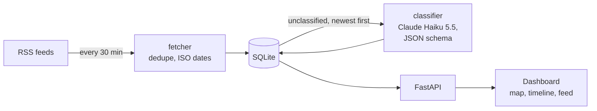

# WorldBrief

A self-hosted world-news dashboard that runs 24/7 on a Raspberry Pi. It pulls articles from RSS feeds every 30 minutes, uses Claude to tag each one with a topic, an importance score and a location, and shows the result on a world map, a timeline and a filterable feed.

## What it does

| | |
|---|---|
| **Collects** | Six RSS sources (BBC World, NPR World, Al Jazeera, The Guardian, Ars Technica, NASA), deduplicated by URL. Feeds are listed in `sources.json`; editing that file adds or retires sources on the next start. |
| **Classifies** | Claude Haiku assigns each article a domain (politics, science, tech, economy, crime, history, other), an importance score from 0 to 1, and the place it is about, with coordinates. |
| **Shows** | A dark dashboard with a Leaflet world map (markers sized by importance, colored by domain), a vis-timeline of the last days, filters by domain, source and time, search over titles and summaries, and an article view. |
| **Flags** | Articles can be marked as important for a later export to Obsidian. |



## Design choices

- **Cheap, schema-checked classification.** Each article is one call to Claude Haiku 5.5 at low effort with a JSON schema, so the response always parses and the domain is always one of the allowed values. At Haiku pricing that is well under a tenth of a cent per article, and a run classifies at most 200 articles so a backlog can't turn into a large bill.
- **Built to run unattended.** A dead feed, a malformed entry or a failed API call is logged and skipped; every classification is saved as soon as it arrives, and articles the model declines are filed under "other" instead of being retried forever. Missing API credentials stop the run with one clear log line.
- **Upgrades in place.** On startup the database adds columns introduced after the first version and rewrites old RFC 822 dates to ISO 8601, so an existing Pi install keeps its history.
- **One process.** FastAPI serves the API and the static dashboard, and APScheduler runs the fetch-then-classify cycle in the background, starting immediately at boot.
- **Feed content is treated as untrusted.** Titles, sources and locations are HTML-escaped in the dashboard, and summaries are reduced to plain text through an inert `DOMParser` document.

## Running it

Requires Python 3.11+ and an [Anthropic API key](https://console.anthropic.com/).

```bash
cp .env.example .env          # add ANTHROPIC_API_KEY
uv sync                       # or: python -m venv .venv && pip install -e .
uv run uvicorn newspulse.api.main:app --host 0.0.0.0 --port 8000
```

Open http://localhost:8000 (or `http://raspberrypi.local:8000` from another device on the network). The first fetch starts right away and classification follows it.

Set `WORLDBRIEF_NO_SCHEDULER=1` to serve the dashboard from an existing database without fetching or calling the API.

### On a Raspberry Pi

A systemd unit keeps it running across reboots. Adjust the user and paths:

```ini
# /etc/systemd/system/worldbrief.service
[Unit]
Description=WorldBrief news dashboard
After=network-online.target

[Service]
User=pi
WorkingDirectory=/home/pi/worldbrief
ExecStart=/home/pi/.local/bin/uv run uvicorn newspulse.api.main:app --host 0.0.0.0 --port 8000
Restart=on-failure

[Install]
WantedBy=multi-user.target
```

```bash
sudo systemctl enable --now worldbrief
```

## API

| Method | Path | Description |
|---|---|---|
| GET | `/articles` | Newest first. Optional `domain`, `source_id`, `limit` (1-1000, default 50) |
| GET | `/articles/{id}` | One article, 404 if missing |
| GET | `/sources` | Active sources |
| POST | `/articles/{id}/mark-important` | Flag an article for export |

Interactive docs are at `/docs`.

## Project layout

```
newspulse/
  db.py            SQLite schema, in-place migrations, source sync
  fetcher.py       RSS fetching, deduplication, date normalization
  classifier.py    Claude classification with structured output
  scheduler.py     fetch-then-classify cycle every 30 minutes
  api/             FastAPI app and routes
static/, templates/  dashboard (vanilla JS, Leaflet, vis-timeline)
sources.json       feed list
tests/             pytest suite (database, fetcher, classifier, API)
```

Run the tests with `uv run --extra dev pytest` (or `pip install -e ".[dev]" && pytest`). They use a temporary database and never call the real API.

## Roadmap

- Export flagged articles to an Obsidian vault as daily notes
- Pull full article text for the sources that allow it, so classification sees more than the summary
- Cluster articles that cover the same story

Map data © OpenStreetMap contributors.
